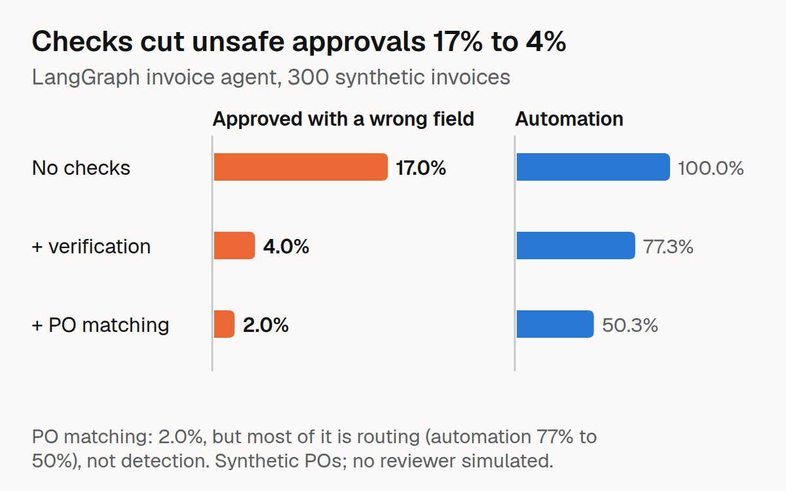
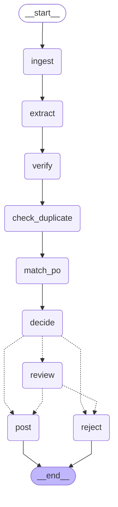
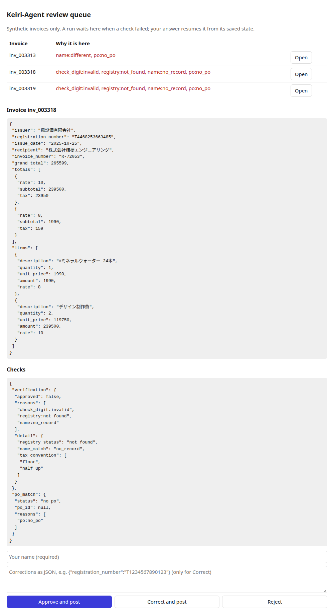

# Keiri-Agent



A LangGraph back-office agent for Japanese qualified invoices (適格請求書). It takes the extraction of [Invoice-Check JP](https://github.com/raihan-js/invoice-check-jp), verifies it, matches a purchase order, and either posts the invoice, sends it to a human reviewer, or rejects it, with an audit trail and a state that survives a restart.

> **Status: all four milestones done (graph, durability and review, LangSmith evaluation, CI gate).** The protocol was fixed in advance in [`docs/PREREGISTRATION.md`](docs/PREREGISTRATION.md); results and the post-hoc analysis are in [`results/REPORT.md`](results/REPORT.md). Everything here runs on **synthetic** invoices, a **synthetic** registry and **synthetic** purchase orders. This is not an accounting product and gives no tax advice.

## The graph



Generated from the compiled graph (`scripts/render_graphs.py`). Three versions are built from the same nodes and compared on the same invoices; each adds one stage:

| Version | Stages | What it trusts |
|---|---|---|
| `v1_extract_only` | ingest, extract, decide, post | the extraction |
| `v2_verify` | + verify (check digit, registry, issuer name, tax arithmetic) | the extraction, if the checks pass |
| `v3_verify_po` | + duplicate check, PO matching | the extraction, if the checks pass **and** a PO agrees; an already posted invoice is rejected |

- **Typed state** (`state.py`): one `InvoiceState`; the only reducer is the append-only `audit` list, so every node adds its own entries and the list is the trail of what the agent did and why.
- **Plain functions, thin framework** (`po.py`, `decide.py`, `review.py`, `ledger.py`, `po_synth.py`): all logic is testable without LangGraph; `graph.py` wires nodes that read state, call a function and write a partial update. No language model sits in the decision path, and nothing is scored by a model.
- **Fails closed:** if a stage a version enables produced nothing, the invoice goes to review.
- **Human review is an `interrupt()`** at the `review` node: the run pauses at a checkpoint and resumes with `Command(resume=...)` on the same thread id. Posting is idempotent on the invoice id, so a re-run after a crash or resume cannot post twice.
- **Reject is narrow:** only a duplicate (same supplier and invoice number already in the ledger) is rejected automatically; everything else that fails goes to a person, because a failed check cannot tell a bad document from a misread one.

## Results (synthetic data; one extractor, one PO seed, one sample of 300)

| 300 test invoices | v1 extract only | v2 + verification | v3 + duplicate check and PO matching |
|---|---|---|---|
| Unsafe auto-approval (approved with a wrong field), of all | 17.0% [12.9, 21.7] | 4.0% [2.1, 6.9] | 2.0% [0.7, 4.3] |
| Automation rate | 100% | 77.3% [72.2, 81.9] | 50.3% [44.5, 56.1] |
| Auto-approved though review or reject was expected | 42.0% | 27.0% | 0.3% [0.0, 1.8] |

On the 200 hold-out invoices (unseen layouts, extractor 51.5% exact): 48.5%, 9.0%, 0.5% unsafe; automation 100%, 52.5%, 32.0%.

**How to read v3.** Its drop from 12 to 6 unsafe approvals (paired p = 0.031, which does not survive a Bonferroni correction over the four pre-registered paired tests) is mostly lower automation: 5 of the 6 invoices were routed away because the synthetic PO world disagreed or the invoice was a duplicate, for reasons unrelated to the wrong field. Where the PO world agrees with the truth, PO matching stopped **1** wrong extraction on the test sample (an item line) and **11 of 12** on the hold-out (item text, the field a PO can see), with no correct extraction stopped there. It does nothing for invoice number or issue date, which is what remains. The precision is flattering: the POs are built from the true item lines. Full tables, the hypothesis scorecard and the limits: [`results/REPORT.md`](results/REPORT.md).

## CI gate

`keiri-gate` runs the graph from a pull request on the frozen 300 invoices (extractions are cached and the graph is deterministic, so the comparison with the committed baseline `results/gate_baseline.json` is exact, invoice by invoice, like FlipGate's per-item flips) and:

- **FAIL**s if an invoice that was not an unsafe auto-approval in the baseline is one now (approved with a wrong field, or approved although review or reject was expected), or if automation drops by more than 5 points (so sending everything to review cannot satisfy it);
- returns **INVALID** if the pinned inputs (gold, extractions, registry) differ from the baseline's hashes, instead of certifying anything;
- never penalises a fix.

What a failing change looks like (here: a graph without the PO and duplicate stages; the six invoices are the ones analysed above):

```
## Keiri-Agent gate: FAIL
- 6 invoice(s) newly auto-approved with a wrong field
- 80 invoice(s) newly auto-approved although review or reject was expected
- Newly unsafe (wrong field): inv_003336, inv_003375, inv_003397, inv_003534, inv_003797, inv_003857
```

`.github/workflows/gate.yml` runs the tests (including the SIGKILL-and-resume ones, against a Postgres service) and the gate on every pull request and writes the report to the job summary. An optional second job uploads the v3 experiment to LangSmith when the repository has a `LANGSMITH_API_KEY` secret (never on forks). Verified in a fresh clone and a fresh virtualenv: 72 passed, 1 skipped (the validation-split oracle needs `scripts/fetch_data.py`), gate exit code 0. Changing the baseline is deliberate: `keiri-gate --update-baseline` in its own commit, with the reason.

## Durability, measured

State lives in PostgreSQL (LangGraph's `PostgresSaver` for checkpoints, a `keiri_ledger` table for postings). `tests/test_restart.py` runs the graph in a subprocess against a real database, kills it with **SIGKILL** at three moments, resumes in a **new process**, and checks the result:

| Kill | What the new process finds | Result after resume |
|---|---|---|
| while the run is paused for review | the run is still at `review`, nothing posted | the reviewer's answer resumes it; one review, one ledger row |
| inside a node (the extractor never returns) | the checkpoint of the previous step, next node `extract` | the run finishes; every audit event appears exactly once; one ledger row |
| right after the ledger INSERT committed, before the `post` checkpoint | a ledger row but a run that still says `post` is next | `post` runs again, `ON CONFLICT DO NOTHING` keeps one row |

**`durability="sync"` is required for this.** LangGraph's default writes a step's checkpoint in the background while the next step runs. Killing a worker inside a node and counting whether the previous step's checkpoint survived (`scripts/durability_ab.py`, 10 trials per mode, a node that blocks inside a synchronous call, sync `PostgresSaver`):

| `durability` | previous step survived the kill |
|---|---|
| `sync` | 10 of 10 |
| `async` (default) | 0 of 10 |
| `exit` | 0 of 10 |

That is one setup, not a law of LangGraph; it is enough to say the default is not safe for a workflow that must not lose a step. Every graph call in `ops.py` and `service.py` passes `durability="sync"`.

**Time travel without touching the live run.** `ops.history` lists a run's checkpoints; `ops.replay` copies the chosen checkpoint into a *new* thread and continues there with a dry-run ledger (reads the real ledger for the duplicate check, writes only to memory), optionally with state values replaced first (a what-if). Replaying a posted invoice cannot post it again, and a what-if cannot leave a pending review on an invoice that was already posted, which LangGraph's native fork on the same thread would.

**Review page and API** (`scripts/serve.py`, FastAPI): `POST /invoices`, `GET /reviews`, `POST /reviews/{id}`, `GET /invoices/{id}` and `/history`, `POST /invoices/{id}/replay`. A reviewer's answer is validated *before* the graph resumes (400, the run stays paused) and only a run that is actually waiting can be answered (409), so a double click cannot resume twice.



## Things that went wrong while building it

- **A bad resume answer poisons the checkpoint.** In LangGraph 1.2.13, a node that raises after `interrupt()` (for example when validating the reviewer's answer) leaves the failed resume value stored; the next `Command(resume=...)` with a *corrected* answer receives the old bad one again, so the invoice can never be resumed. The `review` node therefore never raises on a bad answer: it asks again with the error attached (`tests/test_graph.py::test_a_malformed_reviewer_answer_asks_again_and_can_still_be_resumed`).
- **A shared registry connection returned wrong answers under threads.** In the first LangSmith experiment (two worker threads), 6 invoices were sent to review as `registry:not_found` for numbers that exist, and another run raised `sqlite3.InterfaceError`. One SQLite connection was shared by several threads; the registry is now behind a lock, with a regression test, and the affected experiments were re-run. A wrong value is worse than the exception.
- **LangSmith's aggregate feedback lags and can double count** (302 results for 300 invoices, feedback on 286 distinct runs when read right after the run). The consistency check compares each run's stored outputs with the offline run instead.
- **Replaying an unknown checkpoint re-ran the whole invoice.** LangGraph returns an empty snapshot for a checkpoint id it does not know, and the first version of `replay` treated that like the start of a run and returned 200. A service test caught it; `replay` now refuses an unknown checkpoint and the final one.
- **The default durability mode lost the last step** in the kill test (above): the first version of the restart test failed with the next node `__start__` instead of `extract`, which is how it was found.
- **The oracle test.** With a perfect extraction the full graph must reproduce the expected decision for all 300 validation and all 600 test invoices (`tests/test_oracle.py`). It passed on the first run, so in these 900 cases no purchase order was matched to the wrong invoice and every injected document issue was caught by a check. Disagreements seen later with the real extractor are extraction errors that the checks route to review.

## Reproduce

```bash
python3 -m venv .venv && .venv/bin/pip install -e ".[dev,api]"
.venv/bin/python scripts/fetch_data.py        # gold labels + synthetic registry (public dataset, CC-BY-4.0)
cp .env.example .env && sed -i 's/change-me/<a password>/g' .env && docker compose up -d     # PostgreSQL on 127.0.0.1:55432
.venv/bin/python -m pytest tests -q           # 73 tests (the Postgres ones skip if the database is not reachable)
.venv/bin/python scripts/run_eval.py --name test300 --split test --ids data/eval300_ids.json --preds ../invoice-check-jp/results/preds/qlora_test.jsonl   # offline evaluation
.venv/bin/python scripts/serve.py             # review page at http://127.0.0.1:8800/
```

## Roadmap

1. Graph design: done.
2. Durability and human approval: done (PostgreSQL in Docker, review page and API, SIGKILL-and-resume tests, replay).
3. LangSmith evaluation: done (300-invoice dataset, per-invoice and summary evaluators, three experiments checked against the offline run).
4. CI gate and release: done (exact per-invoice gate, GitHub Action, write-up).

Not yet done: a live extractor served with vLLM (the evaluation replays stored extractions), LangSmith screenshots in the repo (the experiments are listed in `results/langsmith_experiments.md`), and any test on real invoices or purchase orders.

Licence: MIT for the code. Data: Invoice-Check JP (CC-BY-4.0, synthetic). The extractor adapter used elsewhere is non-commercial (Qwen Research License).
